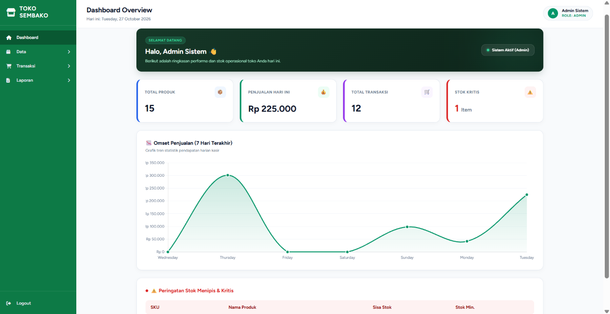
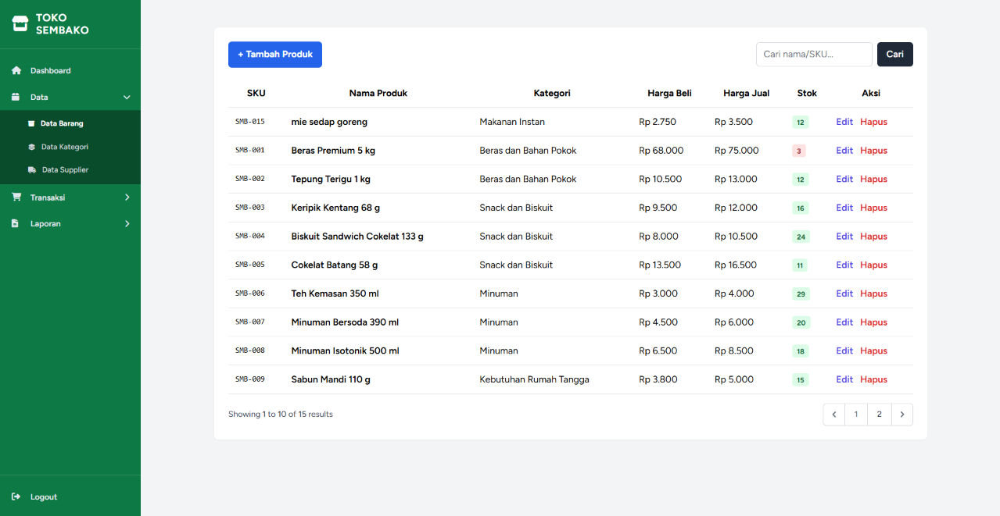
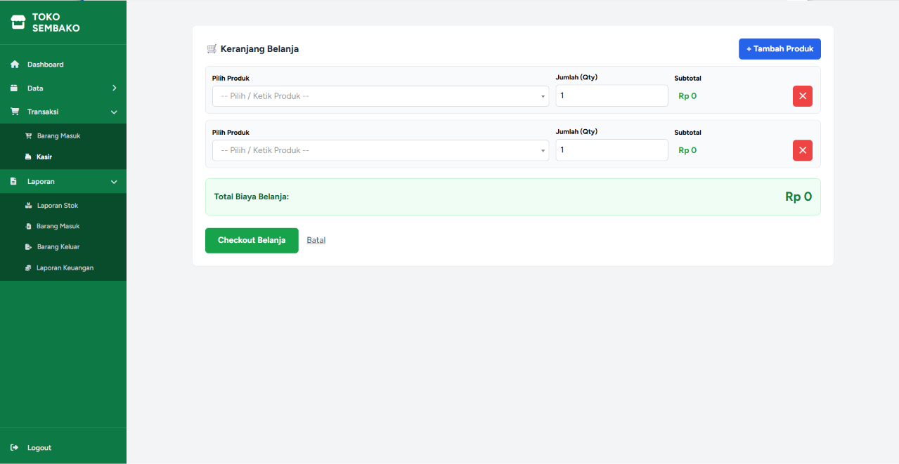
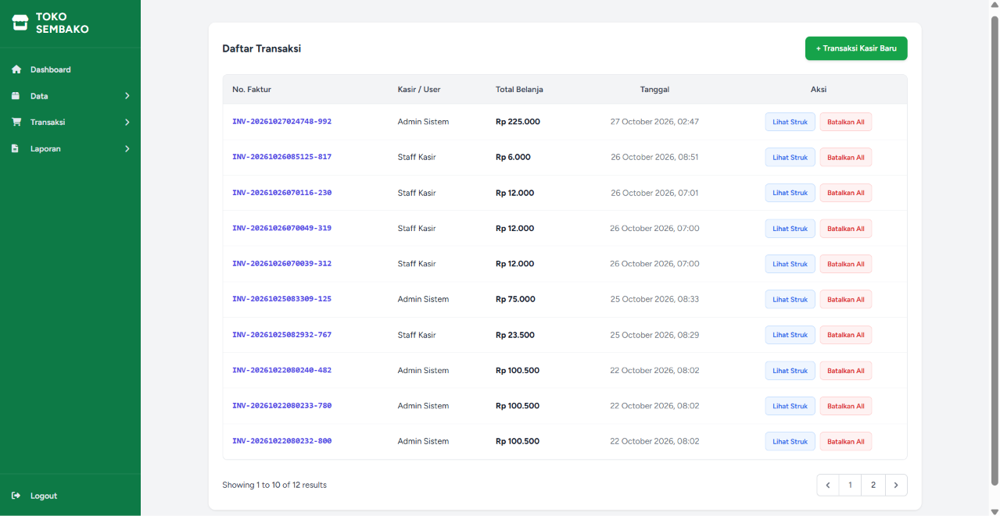

# 🛒 Sistem Informasi Inventaris & Kasir Toko Sembako

Aplikasi manajemen inventaris barang dan transaksi kasir berbasis web yang dibangun menggunakan **Laravel Framework**. Sistem ini dirancang untuk mempermudah pencatatan stok masuk (*purchase*), transaksi penjualan (*sales*), hingga rekapitulasi laporan toko secara otomatis dan real-time.

## 📋 Requirements (Prasyarat Sistem)

Sebelum menjalankan project ini, pastikan perangkat kamu memenuhi spesifikasi berikut:

* **PHP**: >= 8.1

* **Composer**: Latest Version

* **Database**: MySQL / MariaDB

* **Web Server**: Apache / Nginx (Laragon / XAMPP)

* **Node.js & NPM**: (Opsional untuk build assets)

## 🚀 Fitur Utama

Sistem ini dikembangkan sesuai dengan spesifikasi dan batasan ruang lingkup project:

1. **Autentikasi & Hak Akses (Role-Based Access)**

   * Fitur Login / Logout yang aman.

   * Pembatasan hak akses berbasis role (Admin & Kasir) menggunakan Custom Middleware.

2. **Manajemen Master Data**

   * **Kategori Produk**: Pengelompokan jenis barang.

   * **Produk**: Manajemen data barang, SKU otomatis, harga beli, harga jual, stok, dan batas minimum stok.

   * **Supplier**: Pendataan pemasok barang.

3. **Transaksi & Alur Stok Otomatis (Automatic Stock Updates)**

   * **Pembelian (Barang Masuk)**: Menambah jumlah stok produk secara otomatis saat transaksi pembelian berhasil disimpan.

   * **Penjualan (Barang Keluar / Kasir)**: Memotong jumlah stok produk secara otomatis saat transaksi penjualan berhasil disimpan, dilengkapi validasi sisa stok.

   * **Pembatalan Transaksi**: Pengembalian (*restore*) stok produk secara otomatis jika transaksi atau item dibatalkan/dihapus.

4. **Pencarian, Filter & Paginasi (Search, Filter, Pagination)**

   * Pencarian data transaksi berdasarkan nomor faktur (`sale_number`).

   * Pencarian data produk berdasarkan nama atau SKU.

   * Pembagian halaman (*pagination*) di setiap daftar data utama.

5. **Dashboard Interaktif**

   * Banner sapaan sesuai waktu dan pengguna yang login.

   * 4 Ringkasan Kartu Statistik yang interaktif (bisa diklik menuju halaman terkait).

   * Diagram Grafik Penjualan 7 Hari Terakhir berbasis Chart.js bernuansa Hijau Sage (`#2d5a43`).

   * Peringatan (*Alert*) otomatis untuk produk dengan stok menipis/kritis.

6. **Laporan (Reports)**

   * Laporan Stok Barang.

   * Laporan Barang Masuk (Pembelian).

   * Laporan Barang Keluar (Penjualan).

## ⚙️ Panduan Instalasi Project (Installation & Setup)

Ikuti langkah-langkah berikut untuk menjalankan project ini di Laragon/XAMPP:

### 1. Masukkan Project ke Folder `www` Laragon

Pastikan folder project kamu tersimpan di dalam direktori `C:\laragon\www\inventory-sales`.

### 2. Buka Terminal Laragon

Klik tombol **Terminal** di aplikasi Laragon, lalu masuk ke folder project:

```
cd C:\laragon\www\inventory-sales

```

### 3. Install Dependensi PHP

```
composer install

```

### 4. Konfigurasi Environment (`.env`)

Salin file `.env.example` menjadi `.env`:

```
cp .env.example .env

```

Buka file `.env` dan sesuaikan konfigurasi database Laragon (default tanpa password):

```
DB_CONNECTION=mysql
DB_HOST=127.0.0.1
DB_PORT=3306
DB_DATABASE=inventory_sales
DB_USERNAME=root
DB_PASSWORD=

```

### 5. Generate App Key

```
php artisan key:generate

```

### 6. Jalankan Migrasi & Data Dummy (Migration & Seeding)

Buat database `inventory_sales` di **HeidiSQL / phpMyAdmin**, lalu jalankan:

```
php artisan migrate --seed

```

### 7. Akses Aplikasi

Jalankan perintah berikut di terminal:

```
php artisan serve

```

Lalu buka browser dan akses aplikasi melalui: `http://127.0.0.1:8000`

## 🔑 Akun Demo (Demo Accounts)

Gunakan akun default berikut untuk melakukan pengujian aplikasi:

| Role | Email | Password | 
| ----- | ----- | ----- | 
| **Admin** | `admin@gmail.com` | `password` | 
| **Kasir** | `kasir@gmail.com` | `password` | 

## 📊 Diagram Relasi Database (ERD)

> **Catatan File Gambar ERD:**
> Gambar diagram ERD di atas tersimpan pada direktori lokal project: `public/images/erd.png`.

**Penjelasan Relasi Eloquent:**

* `Category` **hasMany** `Products` & `Product` **belongsTo** `Category`

* `Supplier` **hasMany** `Purchases` & `Purchase` **belongsTo** `Supplier`

* `Purchase` **hasMany** `PurchaseItems` & `PurchaseItem` **belongsTo** `Purchase`

* `Sale` **hasMany** `SaleItems` & `SaleItem` **belongsTo** `Sale`

* `User` **hasMany** `Sales` & `Sale` **belongsTo** `User`

## 📝 Catatan Pengujian (Test Cases)

* **Tes Stok Masuk**: Buat transaksi di menu **Barang Masuk**, lalu amati penambahan stok pada daftar **Produk**.

* **Tes Stok Keluar**: Buat transaksi di menu **Kasir / Barang Keluar**, lalu pastikan stok berkurang. Jika kuantitas melebihi stok yang ada, sistem akan menolak transaksi.

* **Tes Pencarian**: Manfaatkan kolom *search* pada daftar produk atau transaksi penjualan untuk memfilter data berdasarkan nomor faktur atau SKU/nama barang.

## ⚠️ Known Limitations (Batasan Aplikasi Saat Ini)

1. Belum terintegrasi dengan Payment Gateway (transaksi saat ini berbasis pembayaran tunai/manual).

2. Cetak struk belanja masih menggunakan format window print browser bawaan (belum terhubung printer thermal pos otomatis).

## 📸 Tampilan Aplikasi (Screenshots)

### 1. Halaman Utama (Dashboard)
Tampilan halaman Dashboard yang menyajikan ringkasan data inventaris serta tabel peringatan stok minim secara real-time.


### 2. Master Data Produk
Halaman pengelolaan data produk (CRUD) yang dilengkapi dengan validasi batas stok minimum (minimal 12 unit).


### 3. Halaman Transaksi Penjualan
Form transaksi kasir untuk memproses pembelian produk oleh pelanggan secara aman.


### 4. Riwayat Penjualan
Tabel daftar riwayat transaksi yang telah berhasil diproses dengan tampilan format tanggal Bahasa Indonesia.
